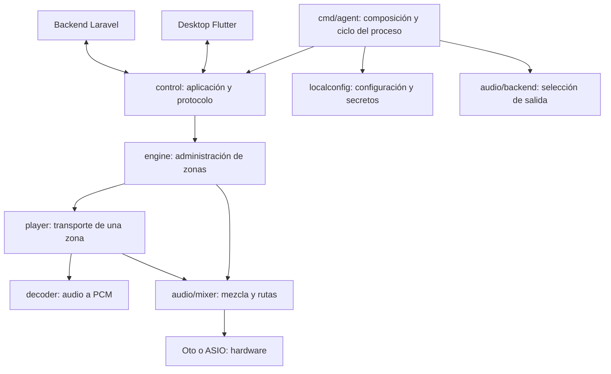

# Arquitectura del engine y responsabilidades de capas

Reorganización del 20/10/2026. Este documento describe el código vigente, los límites que deben conservarse y las partes que todavía pueden mejorar. No se agregaron funciones de audio ni se modificó el contrato del backend en esta tarea.

## 1. Lectura rápida

El dibujo muestra responsabilidades principales. Existen constructores por defecto en engine/player que todavía eligen Oto: no se presenta esta reorganización como una inversión de dependencias completa. La composición beta puede inyectar el backend seleccionado.

## 2. Responsabilidades

| Capa / carpeta | Posee | No debe incorporar |
| --- | --- | --- |
| `cmd/agent` | Argumentos, configuración inicial, backend, señales y apertura/cierre del proceso | Playlists, selección de canción o HTTP duplicado |
| `internal/localconfig` | Configuración local, credenciales protegidas y bloqueo de instancia | Catálogo de negocio o preferencias visuales |
| `internal/control` | Sesión remota, revisiones, comandos, estados y política de aplicación | Widgets o implementación de drivers |
| `internal/engine` | Conjunto de zonas, reproductores, rutas y cierre de recursos compartidos | Autenticación Laravel y JSON de Desktop |
| `internal/player` | Una pista por zona: carga, play/pause/stop, volumen y estado | Revisiones, permisos de negocio o pantallas |
| `internal/decoder` | Lectura, descarga con límites/hash y decodificación MP3 a PCM | Credencial del equipo, selección de zona o backend UI |
| `internal/audio` | Contratos Output/Stream y capacidades de salida | Catálogos y endpoints del negocio |
| `internal/audio/mixer` | Mezcla PCM y asignación de canales | Descarga o administración de playlists |
| `internal/audio/oto` | Salida compartida del sistema | Supuestos de canales físicos ASIO |
| `internal/audio/asio` | Driver, buffers, canales y ciclo de hardware ASIO | Lógica de backend/servidor o Desktop |
| `tools/local-demo` | Herramienta local y consola para desarrollo | Dependencias de la beta productiva |

Los paquetes se conservan: cambiar nombres de carpetas sin reducir responsabilidades no resolvería el acoplamiento y rompería imports innecesariamente.

## 3. Mapa de control: archivos pequeños por responsabilidad

| Archivo en `internal/control` | Responsabilidad |
| --- | --- |
| `doc.go` | Puerta de entrada al paquete y reglas de concurrencia |
| `runtime.go` | Estado compartido, composición de recursos y bucle principal |
| `runtime_configuration.go` | Validación y aplicación atómica de configuración |
| `runtime_reports.go` | Heartbeat para el contrato del servidor |
| `runtime_commands.go` | Validación y ejecución de órdenes por zona/revisión |
| `runtime_sync.go` | Ciclo servidor: configuración, pendientes, diario y confirmaciones |
| `runtime_retry.go` | Espera cancelable y backoff |
| `playback_validation.go` | Comparación de snapshots y validación de formatos/rutas |
| `playback.go` | Aplicación al audio, selección y finalización de cargas |
| `client.go` | Transporte HTTP autenticado y envelope de respuesta |
| `engine_api_routes.go` | Registro de rutas HTTP existentes |
| `websocket.go` | Notificaciones de cambio y reconexión |
| `types.go` | Datos del protocolo remoto |
| `journal.go` | Diario durable de comandos remotos |
| `lock_windows.go`, `lock_unix.go` | Bloqueo del diario por plataforma |
| `desktop_protocol.go` | Solicitudes y eventos públicos del pipe local |
| `desktop_operations.go` | Catálogo de comandos locales y capacidades anunciadas |
| `desktop_commands.go` | Deduplicación por sesión y despacho local |
| `desktop_volume.go` | Volumen temporal, validación y override por revisión |
| `desktop.go` | Resultados y snapshots públicos de observación Desktop |

Se separó código existente sin cambiar firmas de las funciones ni nombres JSON. Las pruebas del paquete pueden seguir encontrando funciones privadas.

## 4. Bloques del arranque productivo

`cmd/agent/main.go` es la raíz de composición. Su función `run` interpreta la operación, obtiene configuración protegida y bloqueo, abre logs, selecciona Oto/ASIO y llama a control. En modo Desktop conecta stdin y stdout mediante `cmd/agent/desktop.go`.

`RunProfileDesktop` tiene cinco bloques documentados en el código:

1. Preparación de cliente y bloqueo de estado.
2. Apertura de sesión y política de reintento.
3. Diario y administrador de audio.
4. Workers de observación, cambios de audio, heartbeat y WebSocket.
5. Bucle principal de sincronización y comandos locales.

El propietario que crea un recurso lo libera. Se cancela el contexto y se espera a los workers antes de cerrar el diario y los reproductores. No mover esos cierres a un widget Flutter ni abrir un backend nuevo por cada comando.

## 5. Flujo de un comando

### Servidor

Backend encola → Client lee → runtime_sync valida y escribe inicio en diario → runtime_commands valida zona/revisión → playback ejecuta → carga puede quedar pendiente → se registra resultado → Client confirma al backend.

El diario no debe omitirse para simplificar: protege contra reejecución después de una caída. Una orden aceptada no equivale a audio reproducido.

### Desktop

Flutter envía solicitud correlacionada → pipe local decodifica → catálogo valida operación → desktop_commands deduplica → aplicación al runtime → command_result y snapshot observado.

Las órdenes locales se deduplican en memoria por sesión. No se confirman como órdenes remotas del servidor. La interfaz no debe modificar directamente el Player ni construir nuevas URLs de audio.

## 6. Estado, bloqueos y volumen

- `Runtime.mu` protege configuración, selección, pendientes y datos consultados por los workers.
- El bucle principal serializa ciclos remotos y solicitudes locales. No introducir otro worker que aplique configuración sin revisar esa condición.
- Player tiene su propio mutex y cancelación/generación de cargas. Una descarga anterior no debe instalarse después de cambiar de canción.
- Manager administra zonas y recursos compartidos; cerrar una pista no debe cerrar la salida de otra zona.
- El volumen de configuración pertenece al servidor. El volumen local de Desktop dura hasta nueva revisión o reinicio.
- El heartbeat conserva el volumen configurado que exige Laravel; el snapshot Desktop muestra el efectivo local. Unificar esos campos sin cambiar primero el contrato rompería la validación del servidor.

Los comentarios agregados a los bloques explican estas condiciones y efectos; no se añaden comentarios a cada asignación trivial.

## 7. Dónde agregar una función

| Cambio | Recorrido |
| --- | --- |
| Nuevo comando de audio local | desktop_protocol → desktop_operations → desktop_commands/handler → engine/player → Flutter catálogo/modelo/controlador/widget |
| Nueva API del servidor | Laravel ruta/permisos/contrato → engine_api_routes → Client/types → runtime → snapshot/modelo Flutter |
| Nombre de artista o título | Dato real backend → Song/types → protocolo/snapshot público → modelo Flutter → presentación |
| Configuración persistente | localconfig → contrato público de cmd/agent/desktop → EngineSettings/formulario Flutter |
| Nuevo backend de audio | audio.Output/Stream → implementación backend → factory/capacidades → composición |
| Preferencia visual | Flutter; no añadirla al reproductor Go |

Añadir una entrada al registro no crea por sí sola una API ni concede permisos. No agregar datos de ejemplo a producción.

## 8. Separación de demo, historial y pruebas

- Demo movida de `cmd/engine` a `tools/local-demo`.
- Consola de demo movida de `internal/console` a `tools/local-demo/console`, con su prueba intacta.
- Instrucciones de música movidas de `music/` a `tools/local-demo/MUSICA.md`.
- Objetivos anteriores movidos de `docs/objetivos` a `docs/historico/objetivos`.
- README anterior archivado, con una entrada nueva enfocada en la beta vigente.
- Eliminadas solamente las carpetas que quedaron vacías después de esos movimientos. No se borraron fuentes, pruebas, historial ni licencias de ASIO.

Las pruebas se separan visualmente con `.vscode/settings.json`; `tests/README.md` ofrece un índice aparte. Físicamente mantienen el paquete Go necesario para acceder a funciones privadas. No se introduce un overlay ni un script especial para simular paquetes.

## 9. Qué sigue pendiente

La reorganización reduce archivos monolíticos, pero no elimina toda la deuda: runtime todavía compone varios workers; player conserva rutas locales y remotas; algunos constructores eligen Oto por defecto. Una fase posterior puede extraer esas dependencias con cambios verificables y alcance propio.

No conviene prometer una reescritura completa mientras se omiten pruebas. En esta tarea se conservan los 25 archivos de prueba, se comprueba su contenido y se compilan el agente beta y la demo. No se ejecutaron suites ni audio físico, conforme a la instrucción vigente.
